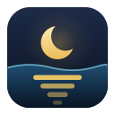
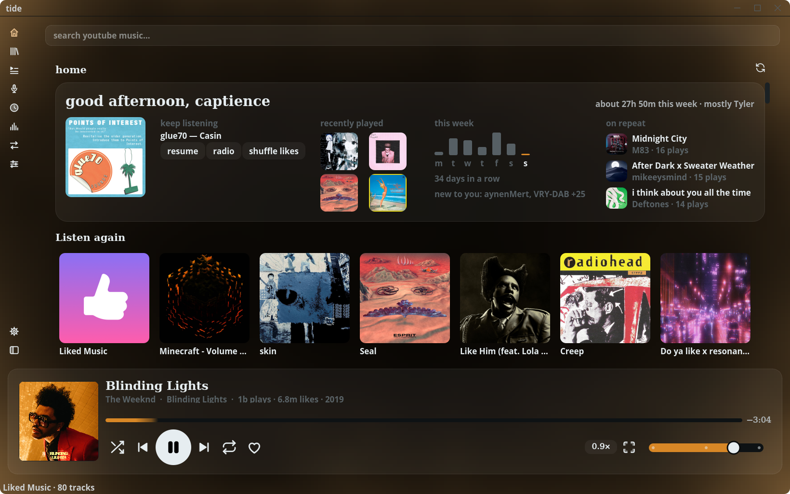
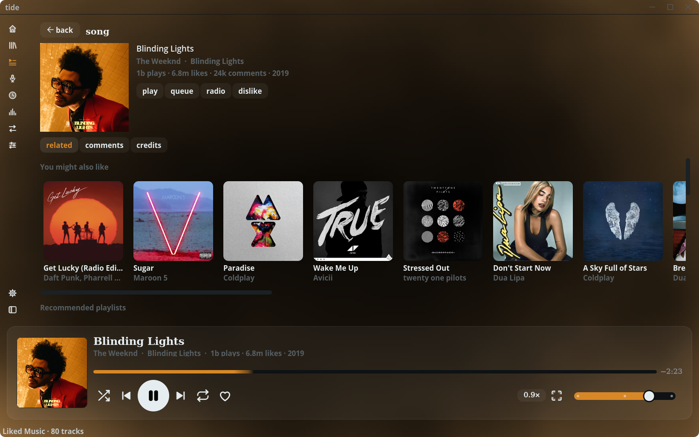
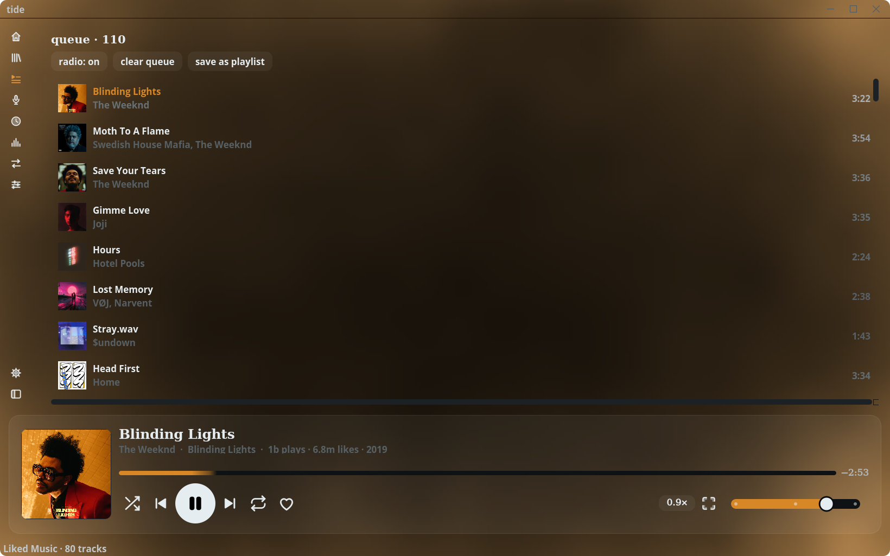
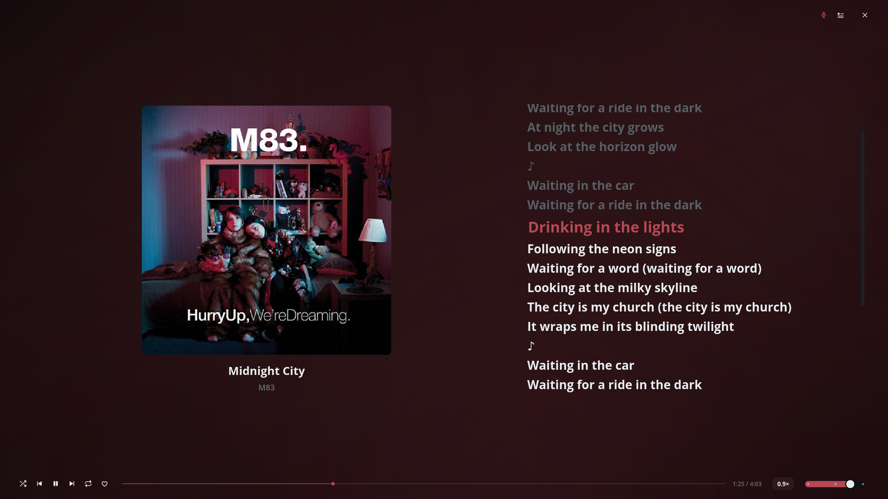
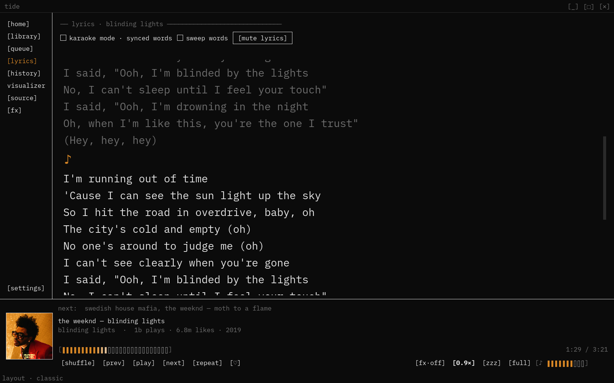
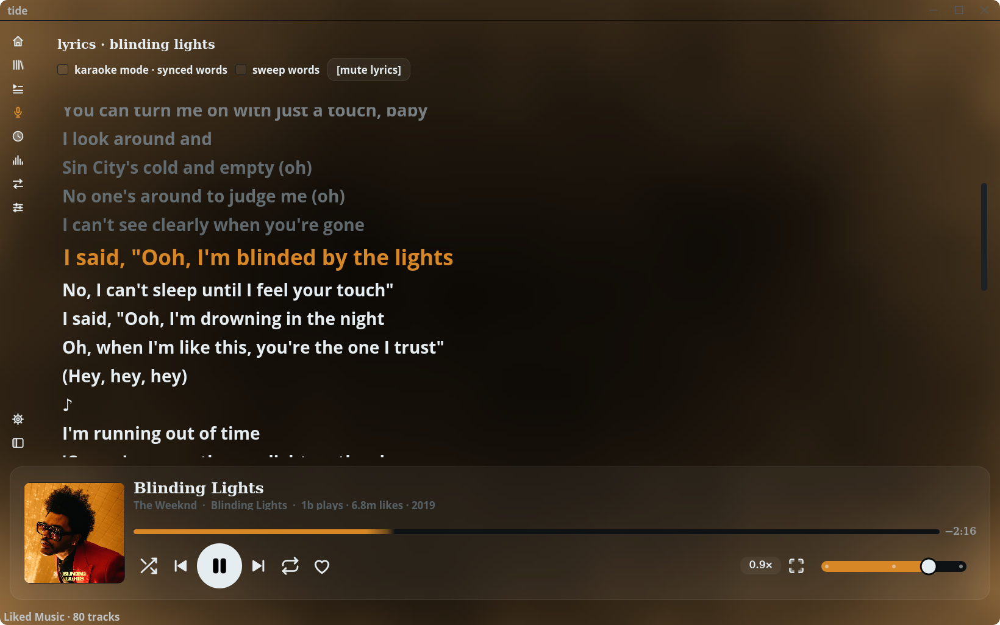

<p align="center">
  
</p>

<h1 align="center">tide</h1>

<p align="center">
  a youtube music client for linux.<br />
  native qt6 on top of mpv, with your whole account in it.
</p>

<p align="center">
  
</p>

```sh
yay -S tide
```

first launch signs you into youtube music through the browser you already use. that's the setup.

## your youtube music, all of it

<table>
  <tr>
    <td width="50%"><br /><b>home.</b> your feed: recently played, quick picks, listen again, charts, new releases, moods.</td>
    <td width="50%"><br /><b>song pages.</b> plays, likes, credits, other recordings, and the comments. timestamps in them seek.</td>
  </tr>
  <tr>
    <td><br /><b>radio.</b> when the queue runs low it keeps going from what you're playing, and skips fan re-uploads. save the queue as a playlist in one click.</td>
    <td><br /><b>lyrics.</b> youtube's own synced lyrics, with lrclib and netease as backup. <code>F11</code> puts them next to big art.</td>
  </tr>
</table>

your library is all there too: songs, albums, artists you follow, playlists. likes, follows and playlist edits go to your account, and history shows what you played everywhere, not only in tide. tide can also report plays so your recommendations keep up (off unless you turn it on).

## two ways to look at it

<table>
  <tr>
    <td width="50%"></td>
    <td width="50%"></td>
  </tr>
  <tr>
    <td><b>brutalist.</b> monospace, hard edges, nothing moves.</td>
    <td><b>modern.</b> springy controls, soft corners, a backdrop that takes its colour from the cover and moves with the bass.</td>
  </tr>
</table>

pick one on first launch and switch whenever. each keeps its own theme and tweaks. 16 themes between them, and a theme editor for more.

## the rest

<table>
  <tr>
    <td width="50%"><br /><b>visualizer.</b> up to four tiles, built from a beat map of the song, so you see the drop coming.</td>
    <td width="50%"><br /><b>your own player bar.</b> long-press it, then drag, resize and pick what shows.</td>
  </tr>
</table>

also: a mini player, a 10-band eq and reverb rack, 0.5× to 2× speed, sleep timer, mpris, tray, discord presence, listenbrainz.

## other sources

youtube music is the main thing. tide can also play these, all in the same queue:

| source | what works |
|---|---|
| local files | search, albums, artists |
| subsonic / navidrome | search, playlists, albums, artists |
| soundcloud, bandcamp, mixcloud | search |
| spotify | search and library only. playback is broken upstream ([why](#spotify)) |

<details>
<summary><b>other distros</b></summary>

there's no package outside the AUR yet. from a checkout:

```sh
git clone https://github.com/captiencelovesarch/tide.git
cd tide
PYTHONPATH=src python -m tide
```

needs python 3.12+, PySide6, mpv + python-mpv, ytmusicapi, yt-dlp, mutagen, cryptography, numpy and spotipy. the visualizer wants `parec` from pipewire-pulse. a flatpak manifest lives in [`flatpak/`](flatpak/) if you want to build one.

</details>

<details>
<summary><b>how sign-in works</b></summary>

google doesn't let outside apps log into youtube music, so tide borrows the session from your browser. it reads the cookies through yt-dlp (chromium, chrome, brave, vivaldi, edge, opera, whale, firefox) with your keyring's permission, and keeps the session fresh while it runs. if google ends it anyway, tide tells you and re-imports in one click. the cookies never leave your machine.

</details>

<details>
<summary><b id="spotify">spotify</b></summary>

search and your library work. playback has been silent since spotify's february 2026 change broke librespot's audio decryption. if librespot fixes it, tide plays again without an update.

</details>

<details>
<summary><b>keys</b></summary>

all rebindable in the keymap editor.

| key | does |
|---|---|
| `Space` | play / pause |
| `Ctrl+←` `Ctrl+→` | previous / next |
| `Ctrl+↑` `Ctrl+↓` | volume |
| `[` `]` `\` | slower / faster / reset speed |
| `Ctrl+1` … `Ctrl+9` | home, library, queue, lyrics, history, visualizer, sources, fx, settings |
| `Ctrl+L` | search |
| `Ctrl+H` | like |
| `Ctrl+M` | mini player |
| `F11` | fullscreen |

</details>

<details>
<summary><b>where your stuff lives</b></summary>

| path | what |
|---|---|
| `~/.config/tide/settings.toml` | settings. the app writes it, you don't have to |
| `~/.config/tide/themes/` | your themes |
| `~/.config/tide/browser.json`, `yt_cookies.txt` | the youtube session (0600) |
| `~/.cache/tide/` | art, lyrics, beat maps, history |

more in [SECURITY.md](SECURITY.md).

</details>

---

[changelog](CHANGELOG.md) · [contributing](CONTRIBUTING.md) · [GPL-3.0-or-later](LICENSE) · not affiliated with youtube, google or spotify

<sub>made with care, claude, and a lot of "lol let's just add that too"</sub>
